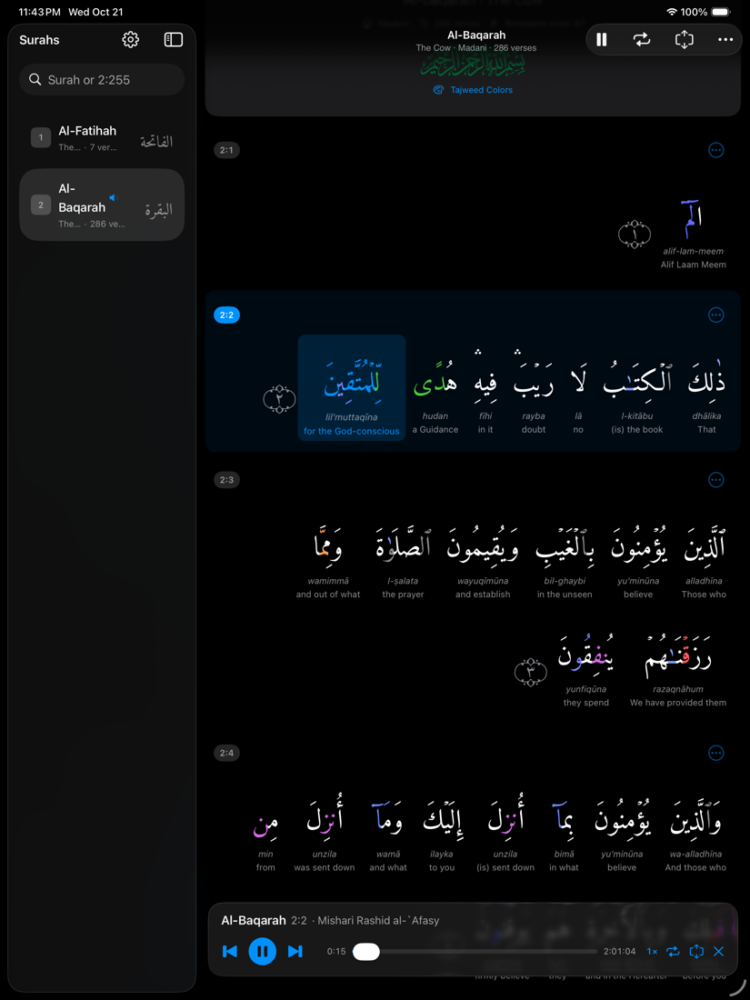
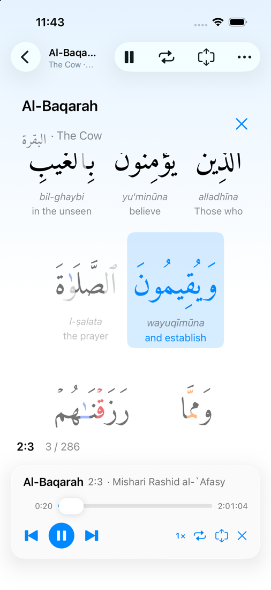

<p align="center">
  
</p>

<h1 align="center">WordsOfGod</h1>

<p align="center">
  A native Quran reader for iPhone, iPad and Mac, with word-by-word recitation, tajweed colors and memorization tools.
</p>

<p align="center">
  
  
</p>

## Features

**Reading**
- Uthmani, IndoPak and Imlaei scripts, set in the bundled Amiri Quran or Scheherazade New fonts
- Tajweed colors for 18 rules, with a color guide
- Word-by-word meaning and transliteration in 10 languages; tap a word to hear it
- Several translations at once, in the order you choose
- Search by surah name or number, or jump straight to a verse such as `2:255`

**Listening**
- Gapless recitation of whole surahs from many reciters
- The word being recited is highlighted, and the page follows along
- A large presentation view that keeps the current verse and word on screen
- Playback speed from 0.5× to 2×; Now Playing and media key support

**Memorizing**
- Repeat each verse, or loop a range of verses, a set number of times or endlessly
- Optional pause between repeats
- Memorization mode blurs the Arabic until it is recited

**Offline**
- Text, translations and word timings you open are kept on the device
- Surahs you play are saved in full in the background (skipped on cellular and Low Data Mode unless you allow it)
- Download one surah or all of them from Settings

## Install on Mac

1. Download `WordsOfGod-<version>.dmg` from [Releases](https://github.com/rifat072/WordsOfGod/releases/latest).
2. Open the DMG and drag **WordsOfGod** to **Applications**.
3. Open the app. The first time, macOS shows a warning that it can't verify the developer, because the app isn't notarized by Apple. Click **Done**.
4. Open **System Settings → Privacy & Security**, scroll down to the message about WordsOfGod and click **Open Anyway**, then confirm.

After that it opens normally. If you prefer the Terminal, this removes the download flag instead of steps 3–4:

```sh
xattr -dr com.apple.quarantine /Applications/WordsOfGod.app
```

The app runs on Apple silicon and Intel Macs with macOS 26 or later. For iPhone and iPad, build it from source with Xcode (see below).

## Requirements

- Xcode 27 or later
- iOS 26, iPadOS 26 or macOS 26 (Tahoe) or later
- Quran Foundation API credentials ([request access](https://api-docs.quran.foundation/docs/tutorials/oidc/getting-started-with-oauth2/#obtaining-oauth-20-client-credentials))

## Getting started

1. Clone the repository.
2. Copy the credentials template and fill in your client ID and secret:

   ```sh
   cp Config/Secrets.example.xcconfig Config/Secrets.xcconfig
   ```

   Debug builds use the Quran Foundation pre-production environment, which has limited content. Release builds use production. Set `QF_ENVIRONMENT` in the file to change this.
3. Open `WordsOfGod.xcodeproj` and run the **WordsOfGod** scheme on a Mac, iPhone or iPad.

To build the Mac DMG, run `./scripts/build-dmg.sh`. It writes `dist/WordsOfGod-<version>.dmg`, a universal, sandboxed build signed ad hoc (no paid Apple Developer account needed).

`Config/Secrets.xcconfig` is listed in `.gitignore`, so your credentials stay out of the repository. They are still compiled into the app's `Info.plist`, so anyone with a built copy of the app can read them.

## How it works

| Area | Where |
| --- | --- |
| API client, token handling, response cache fallback | `WordsOfGod/APIClient` |
| Recitation player: word sync, repeat, Now Playing | `WordsOfGod/Playback` |
| Offline storage, downloads, streaming cache | `WordsOfGod/Offline` |
| Tajweed rules and colored text | `WordsOfGod/Tajweed` |
| Reader, player bar, presentation view, settings | `WordsOfGod/Views` |
| Platform differences (iOS and macOS) | `WordsOfGod/Platform` and `#if os(...)` blocks |

Word highlighting uses the chapter recitation endpoint with `segments=true`, which returns the start and end time of every word. The player looks up the current verse and word as it plays and updates only when they change.

## Acknowledgements

- [Quran Foundation Content API](https://api-docs.quran.foundation): Quran text, translations, word-by-word data, recitations and word timings
- [Amiri Quran](https://github.com/aliftype/amiri) and [Scheherazade New](https://github.com/silnrsi/font-scheherazade): fonts licensed under the SIL Open Font License 1.1 (license files are in `WordsOfGod/Resources/Fonts`)
- [PersistentAVPlayerItem](https://github.com/rifat072/PersistentAVPlayerItem): caches audio to disk while it streams
- [Bismillah calligraphy](https://commons.wikimedia.org/wiki/File:Bismillah_Calligraphy5.svg) by Warraich Sahib, released into the public domain (CC0) on Wikimedia Commons
- The tajweed color scheme follows the convention used by Quran.com

## License

The source code is released under the [MIT License](LICENSE).

The bundled fonts keep their own SIL Open Font License. Quran text, translations, recitations and timing data come from the Quran Foundation API and their respective authors, and are subject to the API's terms of use.
